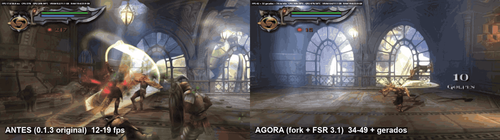

# Fork: AMD FSR 3.1 e correções de desempenho (feito com IA)

> **Tudo neste fork foi feito com IA.** O código, os testes, este texto, o próprio fork no GitHub e a issue enviada ao
> criador foram escritos pelo **Claude** (modelo de IA da Anthropic), conduzido por um usuário (`niw-maker`) que pediu as
> melhorias e jogou para conferir.
>
> **O jogo inteiro ainda não foi testado.** Os testes foram automatizados pela IA (roteiros de botões, medição de tempo de
> cada quadro, gravação e análise de vídeo e de som) na abertura, na primeira área e em 7 saves, mais algumas partidas do
> usuário. Ninguém jogou do começo ao fim com estas mudanças. Espere bugs.
>
> **Você precisa da sua própria ISO** do *God of War II* (EUA, SCUS-97481). Nada do jogo vem neste repositório, e nenhuma
> ISO deve ser enviada a ele.

[English below](#fork-ai-made-amd-fsr-31-and-performance-fixes)



*À esquerda, o port original 0.1.3 como foi baixado; à direita, este fork, na mesma área, com o medidor de FPS (F10). Jogado pelo usuário, sem som, na mesma máquina. O GIF tem 50 quadros por segundo (o máximo do formato); para ver a fluidez completa, baixe o [vídeo de 25 s em 60 fps](docs/comparacao.mp4). A gravação da tela foi feita a 60 fps, então os quadros gerados acima disso não aparecem nela.*

## Base

Este fork parte da **versão 0.1.3** do port do [otavix010](https://github.com/otavix010/god-of-war-2-pc) (commit `96c38ea`),
que ainda gerava o jogo com o PS2Recomp e patches. A partir da 0.1.4 o criador passou a usar um motor próprio, distribuído
compilado, e estas mudanças não se aplicam a ele diretamente. Elas estão no patch `patches/zz_claude_gs_audio.patch` (sobre o
PS2Recomp fixado) e nos arquivos listados abaixo, para quem quiser levá-las adiante.

## O que muda

**Imagem e fluidez**
- **AMD FSR 3.1 (geração de quadros)**, opção "AMD FSR 3.1 (recomendado)" no launcher: o jogo continua desenhando em OpenGL,
  e a imagem final passa por uma apresentação em Vulkan, onde o swapchain do FSR 3.1 (FidelityFX SDK 2.4, DLLs assinadas da
  AMD) gera um quadro entre cada dois. Na RTX 3060 a AMD escolhe a versão 3.1.6. Cortes de câmera recomeçam a interpolação;
  vídeos (FMV) passam sem geração.
- **Um quadro em cada quatro se perdia** entre o jogo e a janela (a janela capturava por vsync, fora de fase com as cópias
  do jogo): agora todos os quadros chegam à tela, com ou sem o FSR.
- **Pausas da tela de 70 a 400 ms** vindas da thread da janela (um registro de depuração que travava um mutex do GS e a
  gravação do registro de quadros no disco) foram eliminadas.
- **Thread de desenho do GS pelo launcher**: o `ambiente.txt` era lido depois de o GS decidir se usava a thread própria.
  (O criador corrigiu o mesmo problema no motor 0.1.2.)

**Launcher (`launcher\`)**
- Aba **Instalação**: instala as dependências pelo winget e gera o jogo a partir da sua ISO, sem terminal.
- **Diagnóstico completo**: cada partida grava em `out\diagnosticos` o registro, o tempo de cada quadro, um vídeo da janela
  (ffmpeg) e as opções usadas.
- Medidor (F10) com os quadros gerados: "FPS x + y gerados = z na tela".

**Jogo**
- Start pula as cutscenes em vídeo; o volume dos vídeos segue o volume do jogo.
- Relógio do cartão de memória no fuso do PS2 japonês (data dos saves correta); F5 abre o menu de salvar em qualquer ponto
  (`jogar_dev.cmd`).
- Espera do FINISH do GS adaptativa (sem ela nas áreas pesadas, onde o processador e o GS trabalham em paralelo).

## Medido (i7-10700, RTX 3060, tela cheia 1080p, FSR 1 + FXAA, aberto pelo launcher)

| Trecho | 0.1.3 original | Este fork |
|---|---|---|
| Primeira área, combate | 12-19 fps, linha bugada embaixo | 34-49 fps reais, ~70-90 na tela com o FSR 3.1 |
| Saves com pouca luta (7 testados) | 47-60 | 58-60 |

## Como instalar (jeito fácil)

1. Baixe o instalador `GoW2-fork-IA-setup-*.exe` na página de [Releases](https://github.com/niw-maker/god-of-war-2-pc/releases/latest)
   e instale (pasta padrão `C:\GoW2`; ele cria atalhos no Menu Iniciar e na Área de Trabalho).
2. Abra o **God of War II** pelo atalho. Na aba **Instalação**, clique em **"Instalar tudo e gerar o jogo"** e escolha a **sua** ISO.
   Uma janela instala o que faltar (Python, compilador C++, Vulkan SDK) e gera o jogo: espere ela dizer **PRONTO**
   (30 min a 1h30; se o Windows pedir permissão, clique em Sim).
3. Clique em **JOGAR**. Em "Frame generation", deixe "AMD FSR 3.1 (recomendado)".

Precisa de Windows 10/11 de 64 bits, processador com AVX2, 16 GB de RAM e uns 25 GB livres.

**Sem o instalador:** com o código deste repositório numa pasta sem espaços, clique duas vezes em `launcher\compilar.cmd` e
abra `GoW2 Launcher.exe`, ou rode `instalar_tudo.ps1 -Iso <sua ISO>`.

Sem o launcher: `gerar.cmd` e `jogar.cmd`, como no original. Sem o Vulkan SDK, o jogo compila igual, só que sem o FSR 3.1.

## Problemas conhecidos
- A ampliação temporal do FSR 3.1 não foi feita: precisa de vetores de movimento, e a câmera da memória do jogo não explica
  um balanço de 6-7 px por quadro (investigação em andamento).
- Nas áreas mais pesadas o jogo fica em ~38-45 fps reais num i7-10700 (a emulação do VU1 é o gargalo).
- O erro `989 ERROR 55` do som apareceu uma vez ao carregar um save e não se repetiu.
- O aviso "controle removido" apareceu uma vez ao ligar o DualSense com o jogo aberto.

## Créditos
- Port original: [otavix010](https://github.com/otavix010/god-of-war-2-pc).
- Ideias e endereços da espera do FINISH: [cxldsakeb](https://github.com/cxldsakeb) (GoW2-nativo-PS2, GPL-3.0).
- [PS2Recomp](https://github.com/ran-j/PS2Recomp) (ran-j); [AMD FidelityFX SDK](https://github.com/GPUOpen-LibrariesAndSDKs/FidelityFX-SDK)
  (licença MIT; as DLLs são baixadas pelo gerador, não vêm no repositório).

---

# Fork (AI-made): AMD FSR 3.1 and performance fixes

> **Everything in this fork was made with AI.** The code, the tests, this text, the GitHub fork itself and the issue sent
> to the original author were written by **Claude** (Anthropic's AI model), directed by a user (`niw-maker`) who asked for
> the improvements and played to check them.
>
> **The whole game has not been tested yet.** Testing was automated by the AI (button scripts, per-frame timing, video and
> audio capture and analysis) on the intro, the first area and 7 saves, plus a few play sessions by the user. Nobody has
> played it start to finish with these changes. Expect bugs.
>
> **You need your own ISO** of *God of War II* (USA, SCUS-97481). No game data is in this repository, and no ISO should
> ever be uploaded to it.

Based on the original port's **0.1.3** (commit `96c38ea`, PS2Recomp + patches). From 0.1.4 on the author uses his own
prebuilt engine, so these changes don't apply to it directly; they live in `patches/zz_claude_gs_audio.patch` and the files
below for anyone who wants to carry them forward.

**Changes:** AMD FSR 3.1 frame generation through a Vulkan presenter on top of the OpenGL renderer (FidelityFX SDK 2.4,
AMD-signed DLLs; scene cuts reset it, FMVs pass through); one frame in four was being lost between the game and the window
(fixed); 70-400 ms window stalls removed; the launcher lost the GS drawing thread because `ambiente.txt` was read too late
(also fixed by the author in engine 0.1.2); a launcher with an **Install** tab (dependencies via winget, generate from your
ISO) and a **full diagnostics** mode (log, frame times, window video); FPS meter shows generated frames; Start skips FMVs;
FMV volume follows the game; memory card clock; adaptive GS FINISH wait.


*Left: original 0.1.3 as downloaded; right: this fork, same area, FPS meter on. Played by the user, same PC. The GIF runs at 50 fps (the format's practical limit); download the [25 s 60 fps video](docs/comparacao.mp4) to see the full smoothness. The screen capture ran at 60 fps, so generated frames above that aren't in it.*

**Measured** (i7-10700, RTX 3060, fullscreen 1080p, from the launcher): first-area combat 12-19 fps → 34-49 real fps, ~70-90 shown
with FSR 3.1; light saves 47-60 → 58-60.

**How to install:** download `GoW2-fork-IA-setup-*.exe` from [Releases](https://github.com/niw-maker/god-of-war-2-pc/releases/latest),
install it (default `C:\GoW2`, Start menu and desktop shortcuts), open it, Install tab → "Instalar tudo e gerar o jogo" and pick
**your** ISO; one window installs what's missing (Python, C++ build tools, Vulkan SDK) and generates the game. Then PLAY.

**Known issues:** no FSR 3.1 temporal upscaling yet (motion vectors); heaviest areas ~38-45 real fps on an i7-10700 (VU1
emulation bound); one-off `989 ERROR 55` sound error and one "controller removed" message on hot-plug.

**Credits:** otavix010 (original port), cxldsakeb (FINISH-wait idea and addresses, GoW2-nativo-PS2, GPL-3.0), ran-j
(PS2Recomp), AMD (FidelityFX SDK, MIT).

---

*Abaixo, o README original da versão 0.1.3 do criador / original 0.1.3 README by the author:*

# God of War II — port nativo para PC

> **Projeto de fãs, sem fins lucrativos.** *God of War II* e *God of War* são marcas da Sony Interactive Entertainment; o jogo foi desenvolvido pelo Santa Monica Studio. Este projeto não tem relação com a Sony Interactive Entertainment. Este repositório **não contém o jogo**: você precisa da **sua própria cópia** do DVD (a versão americana, **SCUS-97481**).

[English summary below](#english-summary)

## O que é

Um port **nativo** do *God of War II* (PlayStation 2, 2007) para Windows. Não é um emulador: o código do jogo é **traduzido para C++ e compilado** para x86-64 (recompilação estática), em cima do [PS2Recomp](https://github.com/ran-j/PS2Recomp).

Como o código do jogo não pode ser distribuído, **o seu PC gera e compila a parte do jogo a partir da sua ISO**. Um comando só faz tudo.

## Estado atual: beta

O jogo roda do começo, com som, vídeos e gráficos como no PlayStation 2. **Roda a 60 FPS em PCs atuais** (testado num Ryzen 7 9800X3D). Num notebook com processador de 4 núcleos (i5 de 8ª geração), use o **modo 30 FPS**, que segura o ritmo estável. A parte gráfica do console (GS) roda na placa de vídeo (OpenGL 4.3). Os microprogramas de geometria do VU1 são traduzidos para C++ na sua máquina, a partir do executável do seu disco (a etapa "VU1" do gerador).

Problemas conhecidos: em alguns PCs o vídeo de abertura pode travar de vez em quando (feche e abra de novo); uma faixa verde fina aparece nas últimas linhas da imagem em algumas telas. Relate o que encontrar pelo launcher.

## Opções

Pelo [Otavix Launcher](https://github.com/otavix010/otavix-launcher/releases/latest), no menu de opções do jogo: **30 ou 60 FPS**, janela ou **tela cheia** (no jogo, F11 ou Alt+Enter alternam), tamanho da janela, escalonador (**bilinear, AMD FSR 1 ou NVIDIA Image Scaling**) e a nitidez dele, anti-serrilhamento **FXAA**, proporção 4:3, 16:9, 21:9 e 32:9 (ultrawide) e predefinições (Notebook / PC fraco, Equilibrado, Qualidade). Sem o launcher, as mesmas opções são variáveis de ambiente: `PS2X_QPS=30`, `PS2X_TELA_CHEIA=1`, `PS2X_JANELA_TAM=1920x1080`, `PS2X_ESCALA=nenhum|bilinear|fsr|nis`, `PS2X_NITIDEZ_PCT=0..100`, `PS2X_FXAA=1`, `PS2X_ASPECTO=4:3|16:9|21:9|32:9|tela|nativo`.

## Como gerar

### Pelo Otavix Launcher

O [Otavix Launcher](https://github.com/otavix010/otavix-launcher/releases/latest) lista este port: ele baixa o port, pede a ISO, gera o jogo e abre.

### À mão

**1. O que você precisa ter:** a sua cópia do *God of War II* **americano** (SCUS-97481, "God of War II (USA)") como imagem **.iso** do DVD. O gerador confere o executável do jogo pelo hash: outras versões não servem, porque o mapa de funções é o da americana.

**2. Instale as ferramentas (uma vez só)**, num terminal:
```
winget install Python.Python.3.12
winget install Microsoft.VisualStudio.2022.BuildTools --override "--quiet --wait --add Microsoft.VisualStudio.Workload.VCTools --add Microsoft.VisualStudio.Component.VC.CMake.Project --add Microsoft.VisualStudio.Component.VC.Llvm.Clang --includeRecommended"
```
O resto o gerador baixa sozinho: o PS2Recomp (na versão fixada), as bibliotecas dele e, se o PC não tiver Git, o Git portátil (MinGit).

**3. Baixe este repositório** (botão *Code > Download ZIP*, ou `git clone`) e extraia numa pasta **sem espaços no caminho**, por exemplo `C:\god-of-war-2-pc`. Deixe uns 25 GB livres nesse disco (os arquivos do disco, o código traduzido e a compilação).

**4. Clique duas vezes em `gerar.cmd`** e escolha a ISO. Ele:
- confere a ISO e extrai os arquivos do disco para `trabalho\disc`;
- baixa o PS2Recomp, aplica as nossas correções (`patches\`) e compila o tradutor;
- traduz o código do jogo e os microprogramas do VU1 para C++ (só no seu PC);
- compila o jogo (de 30 minutos a 1 hora e meia, conforme o PC; precisa de 16 GB de RAM ou mais e de um processador com AVX2).

**5. Jogue com `jogar.cmd`.** O jogo lê os arquivos de `trabalho\disc` e a ISO no lugar onde ela estava na geração (se mudar a ISO de lugar, rode `gerar.cmd -RefazerDe 2`).

Depois de atualizar o port, `gerar.cmd -RefazerDe 3` aplica as correções novas, retraduz e recompila sem extrair o disco de novo. Com o componente "C++ Clang tools" do Visual Studio instalado (já incluído no comando acima), a geometria compila com o clang-cl e fica mais rápida.

## Como funciona

- **PS2Recomp** traduz o executável do PS2 (MIPS R5900, o "Emotion Engine") para C++ e compila com o runtime dele.
- **O mapa de funções** (`jogo\ghidra_funcoes.csv`) veio de uma análise com o [Ghidra](https://ghidra-sre.org/) e a extensão [ghidra-emotionengine-reloaded](https://github.com/chaoticgd/ghidra-emotionengine-reloaded): são só endereços e nomes, nada do código do jogo. `jogo\entradas_extra.txt` lista funções chamadas só por ponteiro e alvos de tabelas de salto que a análise não marcou.
- **A receita do VU1** (`jogo\vu1_receita.json`) diz onde os microprogramas de geometria ficam no executável (offsets e tamanhos, conferidos por SHA-1) e como montar a memória de código do VU1; o único trecho que não vem do executável é uma instrução de 8 bytes que o próprio jogo monta enquanto roda.
- **As nossas correções no PS2Recomp** (GPLv3 como ele), em `patches\`: no tradutor (desvios e ponto flutuante como no EE) e no runtime (o "sistema operacional" do console, leitura de setores direto da ISO, o chip de som SPU2 emulado no IOP, vídeos MPEG, o GS desenhado na placa de vídeo, o VU1 traduzido, threads por núcleo e o menu de imagem: FSR 1, NIS e FXAA).
- O modo 30 FPS usa o limitador do próprio jogo (um remendo de memória no endereço 2D80B8, como os que os jogadores usam no PCSX2), aplicado pelo runtime quando `PS2X_QPS=30`.

## Licença e créditos

- **O nosso código** (`gerar.ps1`, `gerar.cmd`, `ferramentas\`): [MIT](LICENSE).
- **PS2Recomp** (baixado pelo gerador) e **as nossas correções nele** (`patches\`): [GPLv3](https://github.com/ran-j/PS2Recomp/blob/main/LICENSE), de ran-j e colaboradores. O executável gerado no seu PC também é GPLv3.
- O NIS vem do [NVIDIA Image Scaling SDK](https://github.com/NVIDIAGameWorks/NVIDIAImageScaling) (MIT) e o FSR 1 do [AMD FidelityFX FSR](https://github.com/GPUOpen-Effects/FidelityFX-FSR) (MIT).
- *God of War II* e *God of War* são marcas da Sony Interactive Entertainment. Este é um projeto de fãs, sem fins lucrativos, sem relação com a Sony Interactive Entertainment nem o Santa Monica Studio nem endossado por eles.

## English summary

A **native PC port** of *God of War II* (PlayStation 2, 2007) made by **static recompilation** with [PS2Recomp](https://github.com/ran-j/PS2Recomp). **Beta.** It runs from the start with sound, videos and PS2-accurate graphics, at **60 FPS on current PCs**; on 4-core laptops use the **30 FPS mode**. The console's graphics chip (GS) runs on your GPU (OpenGL 4.3). Options in the launcher: 30/60 FPS, window or fullscreen (F11 / Alt+Enter), window size, upscaler (bilinear, AMD FSR 1, NVIDIA Image Scaling) and sharpness, FXAA, aspect ratio 4:3, 16:9, 21:9 and 32:9 (ultrawide).

**Bring your own game**: no game code or data here, only the function map (addresses), translation settings and the VU1 "recipe" (offsets and sizes in your executable). You need the **US** release (SCUS-97481, Redump "God of War II (USA)") as an **.iso**. Install Python 3.11+ and Visual Studio 2022 Build Tools with C++, CMake and Clang (commands above), download this repository to a path without spaces with about 25 GB free, double-click **`gerar.cmd`** (it checks your ISO, extracts the disc files, fetches the pinned PS2Recomp, applies our patches, translates the game code on your PC and builds it; 16 GB of RAM and an AVX2 CPU needed), then play with **`jogar.cmd`**.

License: our scripts are MIT; PS2Recomp and our patches to it are GPLv3. *God of War II* and *God of War* are trademarks of Sony Interactive Entertainment; this is a non-commercial fan project, not affiliated with or endorsed by Sony Interactive Entertainment or Santa Monica Studio.
